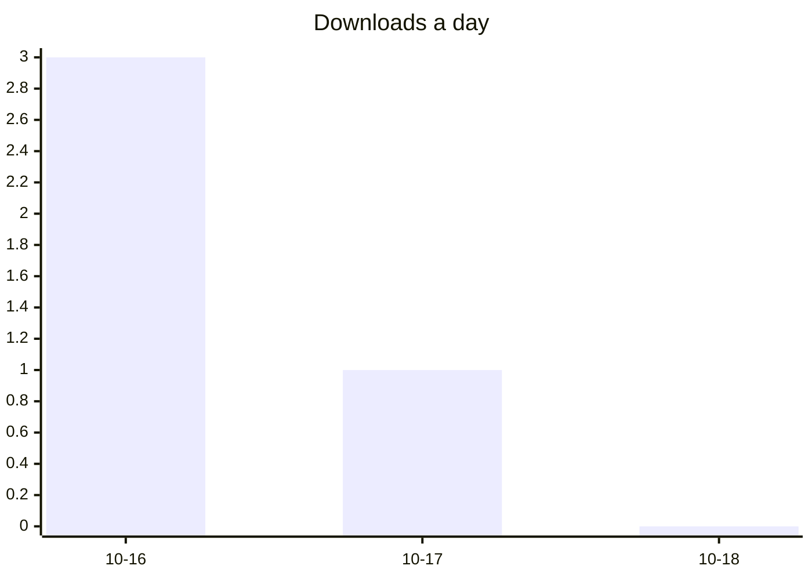
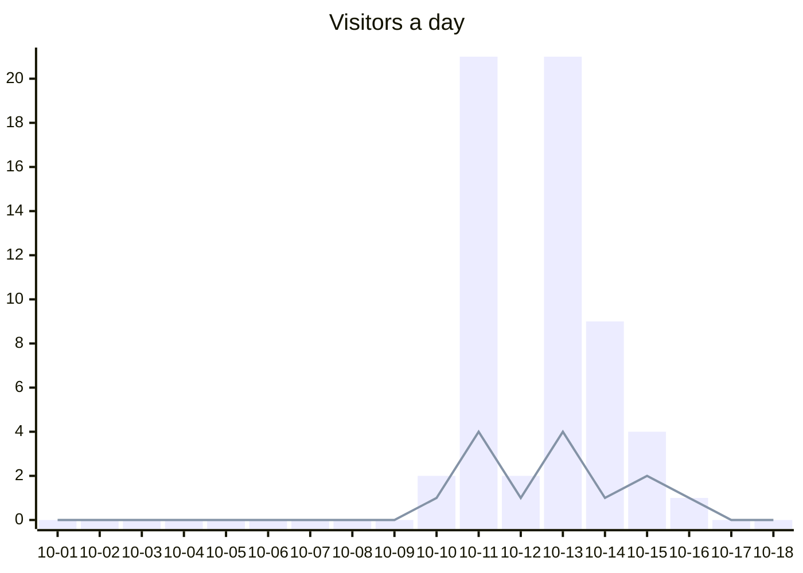

# Usage statistics

Written every day by [the stats workflow](https://github.com/ArtemkaGoldMan/ContextSwitcher/blob/main/.github/workflows/stats.yml); [what the numbers mean](https://github.com/ArtemkaGoldMan/ContextSwitcher/blob/main/docs/usage-statistics.md). Last run 2026-10-18 (UTC).

## Downloads

Every download counts, not every person: one person downloading twice is two. The `.zip` is what the app's own updater, `install.sh` and Homebrew download, so it is roughly the copies that installed or updated to that version; the `.dmg` is downloaded by hand.

| Release | Published | .dmg | .zip |
| --- | --- | ---: | ---: |
| v0.6.7 | 2026-10-16 | 0 | 0 |
| v0.6.6 | 2026-10-15 | 0 | 1 |
| v0.6.5 | 2026-10-15 | 0 | 2 |
| v0.6.4 | 2026-10-15 | 0 | 0 |
| v0.6.3 | 2026-10-14 | 0 | 2 |
| v0.6.2 | 2026-10-14 | 0 | 1 |
| v0.6.1 | 2026-10-14 | 0 | 0 |
| v0.6.0 | 2026-10-14 | 0 | 1 |
| v0.5.0 | 2026-10-13 | 0 | 8 |
| v0.4.1 | 2026-10-13 | 1 | 2 |
| v0.4.0 | 2026-10-12 | 0 | 2 |
| v0.3.0 | 2026-10-11 | 0 | 2 |
| v0.2.0 | 2026-10-10 | 0 | 1 |
| v0.1.0 | 2026-10-10 | 0 | 1 |
| **All** | | **1** | **23** |

Downloads a day (`.dmg` and `.zip`), from one run's totals to the next:

## Visitors

Views of the repository's pages on GitHub and the people behind them, a day. Bars: views. Line: different visitors.

| Day | Views | Visitors | Clones |
| --- | ---: | ---: | ---: |
| 2026-10-18 | 0 | 0 | 0 |
| 2026-10-17 | 0 | 0 | 0 |
| 2026-10-16 | 1 | 1 | 193 |
| 2026-10-15 | 4 | 2 | 338 |
| 2026-10-14 | 9 | 1 | 404 |
| 2026-10-13 | 21 | 4 | 210 |
| 2026-10-12 | 2 | 1 | 117 |
| 2026-10-11 | 21 | 4 | 94 |
| 2026-10-10 | 2 | 1 | 39 |
| 2026-10-09 | 0 | 0 | 0 |
| 2026-10-08 | 0 | 0 | 1 |
| 2026-10-07 | 0 | 0 | 0 |
| 2026-10-06 | 0 | 0 | 1 |
| 2026-10-05 | 0 | 0 | 1 |
| 2026-10-04 | 0 | 0 | 3 |
| 2026-10-03 | 0 | 0 | 0 |
| 2026-10-02 | 0 | 0 | 1 |
| 2026-10-01 | 0 | 0 | 1 |

Clones are almost all automated - CI and bots - and say little about people.

### Where they came from

GitHub's top sites for the 14 days up to 2026-10-18.

| Site | Views | Visitors |
| --- | ---: | ---: |
| artemkagoldman.github.io | 1 | 1 |
| github.com | 1 | 1 |

### What they looked at

GitHub's top pages for the 14 days up to 2026-10-18.

| Page | Views | Visitors |
| --- | ---: | ---: |
| / | 10 | 5 |
| /releases/tag/v0.3.0 | 5 | 4 |
| /pulls | 5 | 1 |
| /releases/tag/v0.4.0 | 4 | 3 |
| /commits/main | 4 | 1 |
| /releases | 4 | 1 |
| /issues | 3 | 1 |
| /actions | 2 | 1 |
| /branches | 2 | 1 |
| /pull/7 | 2 | 1 |
