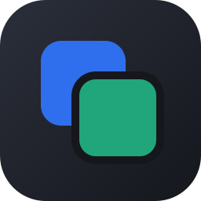
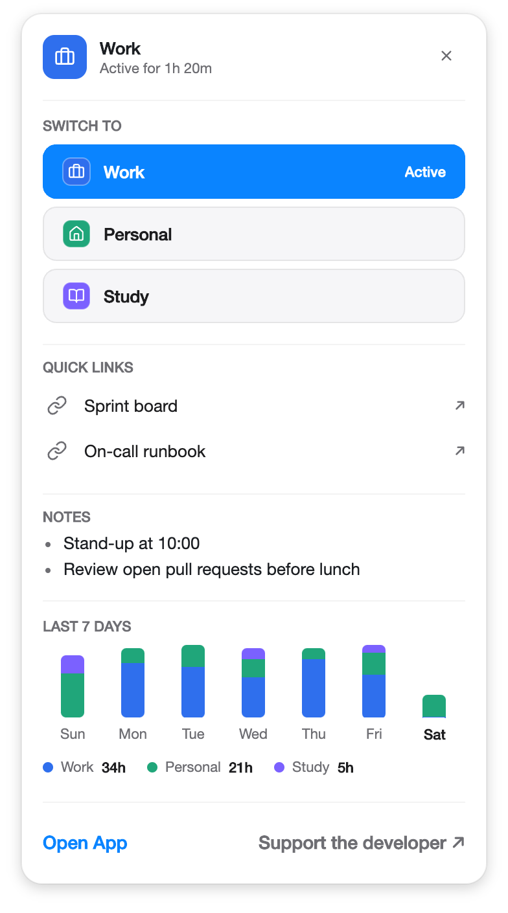
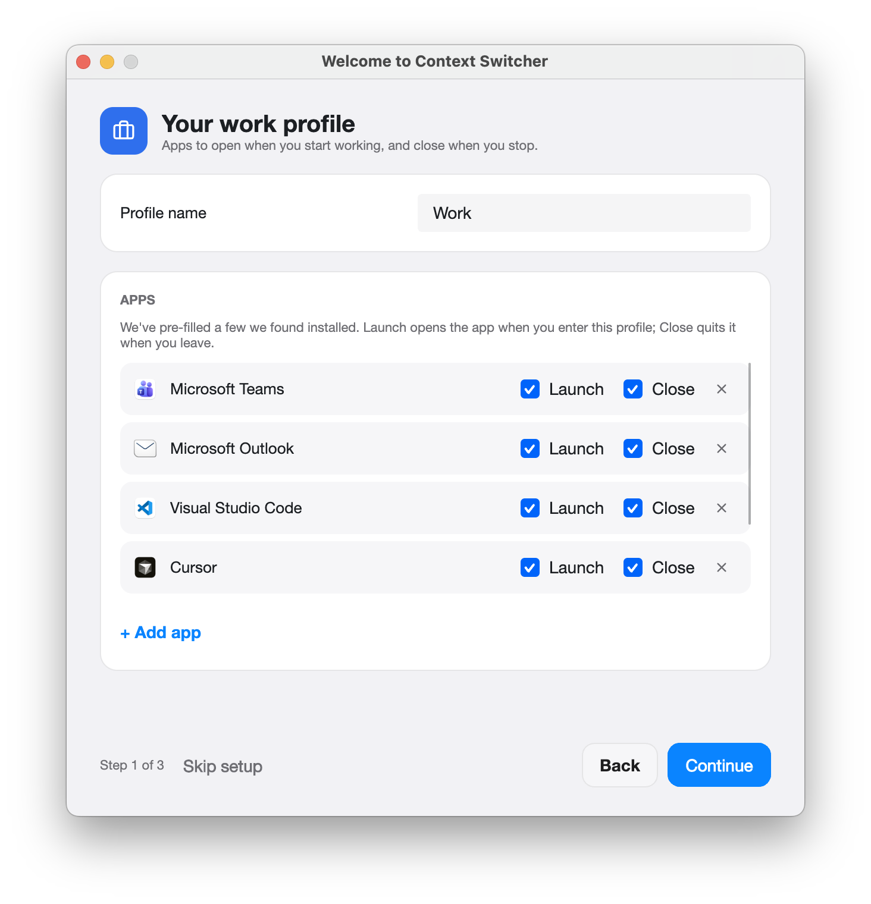
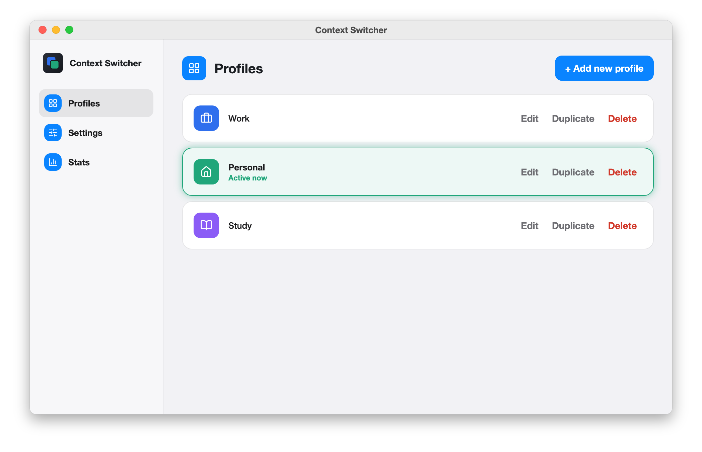
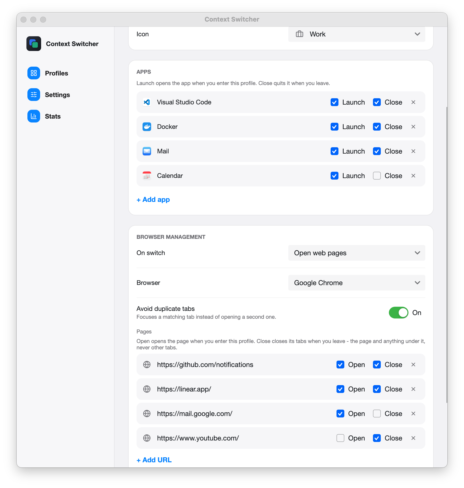
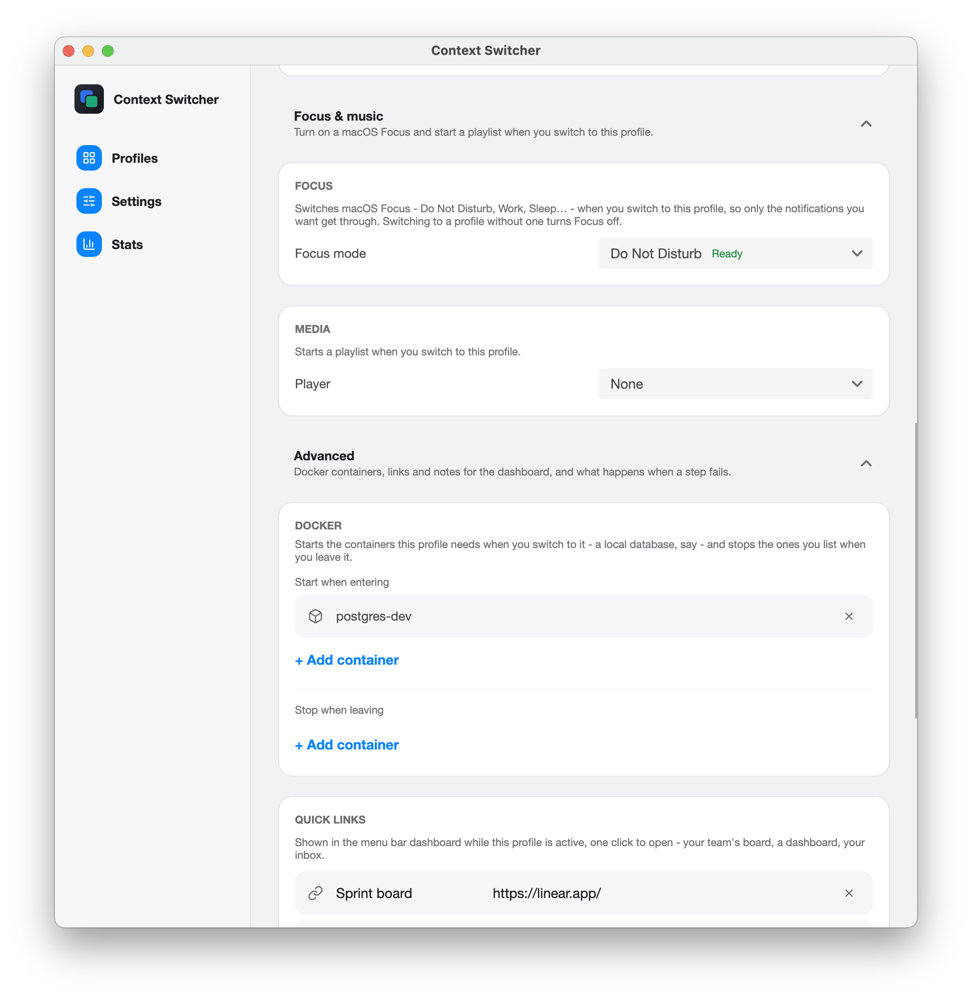
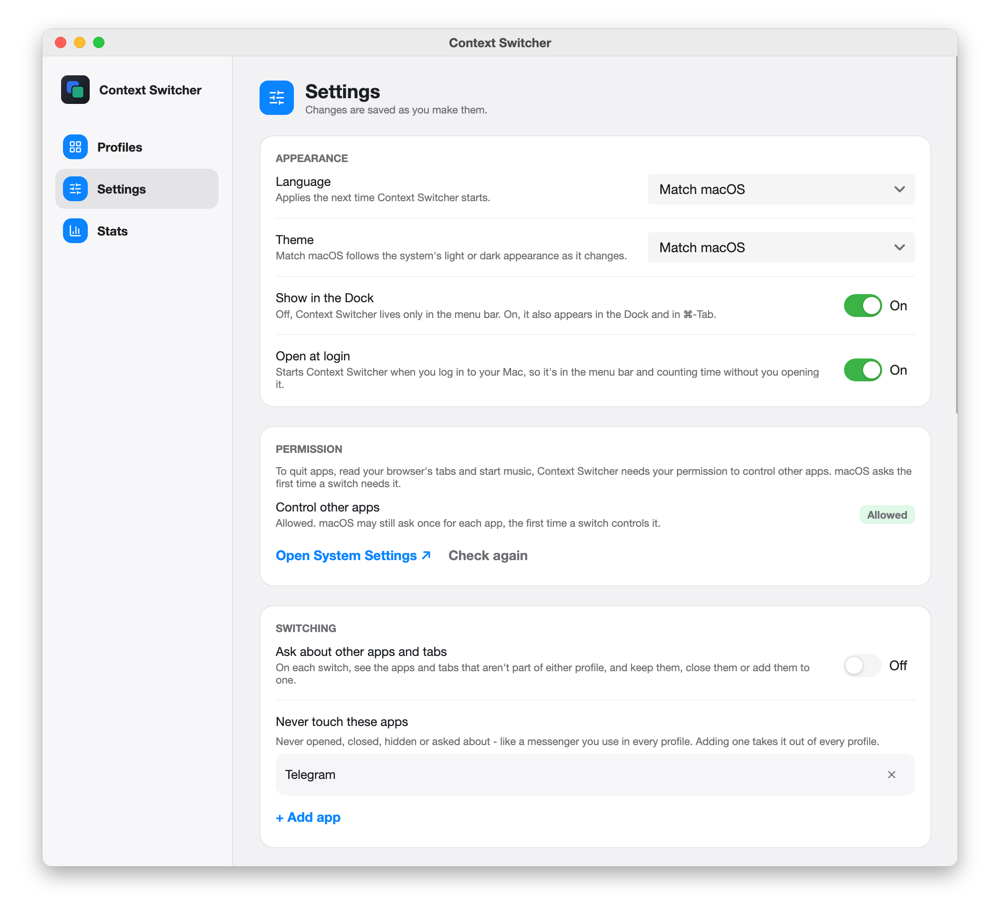
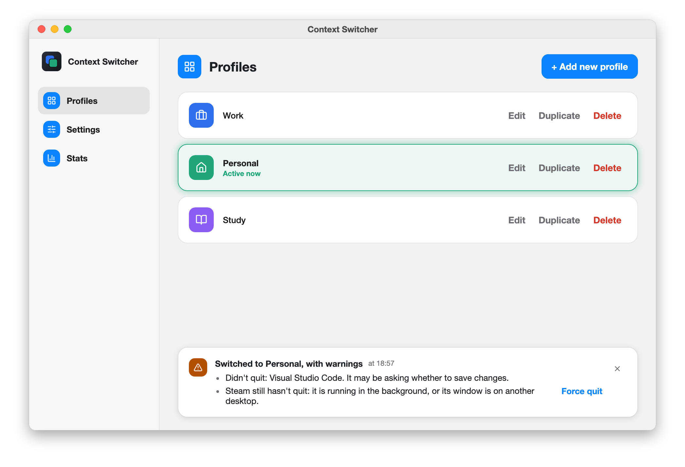
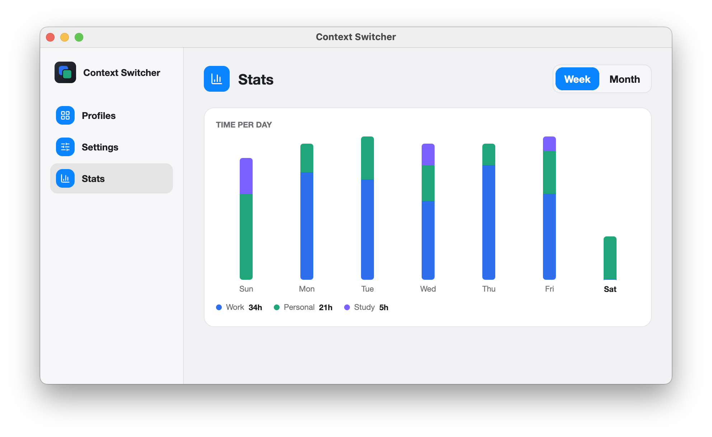

<div align="center">



# ContextSwitcher

**Switch your Mac between work and personal in one click.**

It opens the apps you need, quits the ones you don't, opens your tabs, turns on Focus and starts
your music — all from the menu bar.

<a href="https://github.com/ArtemkaGoldMan/ContextSwitcher/releases/latest"></a>


<picture>
  <source media="(prefers-color-scheme: dark)" srcset="docs/images/dashboard-dark.png">
  
</picture>

[Install](#install) · [Getting started](#getting-started) · [Updates](#updates) · [FAQ](#faq) · [Report a bug](#found-a-bug)

</div>

---

## Why

You finish work. Slack is still pinging, your editor is still open, a dozen work tabs are still
loaded and Do Not Disturb is still on from the morning. Switching by hand takes five minutes, so
you never do all of it — and work follows you into the evening.

ContextSwitcher keeps a **profile** for each part of your day. Click one, and your Mac turns into it:

| | What a profile can do |
| --- | --- |
| **Apps** | Open apps when you switch in, and quit them when you switch out — the polite way, like ⌘Q, never force-quit |
| **Browser** | Open web pages without duplicating tabs that are already open, or a whole Chrome or Brave profile — and close a profile's pages when you leave it, leaving every other tab alone. Safari can switch to a tab group or profile with the profile's Focus |
| **Focus** | Turn on a macOS Focus — Do Not Disturb, Work, Sleep… — and turn it off again when you leave |
| **Music** | Start an Apple Music or Spotify playlist |
| **Docker** | Start the containers this profile needs, stop the ones it doesn't |
| **Dashboard** | Keep a few links and notes for this profile one click away |
| **Time** | See how your week splits between work and the rest of your life, stored only on your Mac |

Every part is optional. A profile that only opens two apps is a perfectly good profile.

## Install

You need a Mac with **Apple silicon** (M1 or later) and **macOS 13 Ventura or later**.

Pick one of the three. Options 1 and 2 are one command and nothing else. Option 3 is a download
**plus one Terminal command you can't skip**.

### Option 1 — one command (recommended)

Open **Terminal** (press ⌘Space, type *Terminal*, press Return), paste this and press Return:

```bash
curl -fsSL https://raw.githubusercontent.com/ArtemkaGoldMan/ContextSwitcher/main/install.sh | bash
```

It downloads the latest version, checks it isn't damaged, puts it in Applications and opens it.
Nothing else to do: macOS doesn't ask you to approve it.

### Option 2 — Homebrew

If you use [Homebrew](https://brew.sh):

```bash
brew install --cask artemkagoldman/tap/contextswitcher
```

### Option 3 — download it yourself

> [!IMPORTANT]
> **This option has a required step in Terminal.** macOS blocks a downloaded copy of
> ContextSwitcher, and the app won't open until you run the command in step 3 —
> [why](#why-the-terminal-command). Options 1 and 2 don't need it.

1. Download **ContextSwitcher-x.y.z.dmg** from the [latest release](https://github.com/ArtemkaGoldMan/ContextSwitcher/releases/latest).
2. Open it and drag **ContextSwitcher** onto **Applications**.
3. **Required: run this in Terminal** (press ⌘Space, type *Terminal*, press Return), then press
   Return once more:

   ```bash
   xattr -dr com.apple.quarantine /Applications/ContextSwitcher.app
   ```

   It prints nothing when it works.
4. Open **ContextSwitcher** from Applications. It lives in the menu bar.

### Why the Terminal command?

**When you need it.** Only when you downloaded the app in a browser — Option 3. Not with Options 1
or 2, and never for updates: the app installs those itself, and they open straight away.

**Why.** Your browser marks everything it downloads as *"from the internet"*. macOS opens such an
app without asking only if its developer pays Apple **$99 a year** for a Developer ID and has every
release *notarised* — checked by Apple. ContextSwitcher is a free hobby project, and **$99 a year is
too much for me**, so it isn't notarised, and macOS blocks it until you allow it once.

**What it does.** The command removes the *"from the internet"* label from this one app. It doesn't
change any security setting on your Mac. Options 1 and 2 never put the label on, which is why they
skip this step.

**What happens without it.** Nothing breaks — the app just doesn't open. macOS shows *"Apple could not
verify ContextSwitcher is free of malware"* with only **Done** and **Move to Trash**. Since macOS 15
there is no right-click → **Open** way around it any more.

**Is it safe?** The app is built by GitHub from the public source code in this repository, which
anyone can read, and every release is signed with the project's own certificate. The app checks that
signature before it installs an update, and refuses one that didn't come from this project.

**Rather not use Terminal?** Try to open the app and click **Done**, then go to **System Settings →
Privacy & Security**, scroll down to *"ContextSwitcher was blocked"* and click **Open Anyway**. It does
the same as the command.

## Getting started

### 1. A short setup

The first time it opens, a three-step wizard creates a **Work** and a **Personal** profile. It
suggests apps you actually have installed: tick **Launch** to open an app when you switch to that
profile, and **Close** to quit it when you switch away. Its last step offers to open ContextSwitcher
whenever you log in, so it's always there and counting time. You can change everything later.

> [!IMPORTANT]
> **Close** starts ticked for the apps it suggests, and finishing the wizard switches you into Work
> straight away. Switching to another profile later quits those apps — politely, like ⌘Q, so
> anything unsaved asks first. Untick **Close** for any app you want left alone.

<div align="center">
<picture>
  <source media="(prefers-color-scheme: dark)" srcset="docs/images/onboarding-dark.png">
  
</picture>
</div>

### 2. Switch from the menu bar

ContextSwitcher lives in the **menu bar** — look for the icon of two overlapping squares — and in
the **Dock**, where clicking it opens the main window. Rather keep it to the menu bar? Turn off
**Settings → Show in the Dock**.

- **Click the icon** and pick a profile to switch to it. The active one has a tick; pick it again to
  turn it off — it closes what it closes when you switch away, and no profile is on until you pick
  one. No time is counted while none is on.
- **Open Dashboard** shows the active profile, how long you've been in it, its quick links and notes,
  and the last seven days. Click anywhere else to close it.
- **Open App** opens the main window, where you set profiles up.

Can't see the icon? On a MacBook with a notch, macOS hides menu bar icons that don't fit. Open
ContextSwitcher again from Applications or Spotlight and its window opens — see the
[FAQ](#faq) for keeping the icon in view.

### 3. Set up your profiles

The **Profiles** page lists every profile: **Activate** switches to it, **Edit** changes what it does.

<div align="center">
<picture>
  <source media="(prefers-color-scheme: dark)" srcset="docs/images/profiles-dark.png">
  
</picture>
</div>

Editing a profile is mostly picking from lists: apps from the apps you have installed, web pages
from the tabs you have open, playlists from your library, containers from Docker. Apps and pages
each have two ticks — open when you enter the profile, close when you leave it — and an app can be
**hidden** instead of quit, so it comes back at once with its windows.

<div align="center">
<picture>
  <source media="(prefers-color-scheme: dark)" srcset="docs/images/profile-setup-dark.png">
  
</picture>
</div>

### 4. Turn on Focus (optional)

macOS doesn't let other apps change Focus directly — only the **Shortcuts** app can. So for each
Focus you use, ContextSwitcher needs two small shortcuts: one that turns it on and one that turns it
off. You don't build them yourself:

1. In **Focus & music**, choose a **Focus mode**.
2. Click **Create it**. Shortcuts opens and asks to **Add Shortcut** — click it. The mode now shows
   **Ready**.
3. If a second **Create it** appears — for the shortcut that turns Focus off — do the same.

<div align="center">
<picture>
  <source media="(prefers-color-scheme: dark)" srcset="docs/images/profile-setup-focus-dark.png">
  
</picture>
</div>

A Focus you created yourself needs the two shortcuts made by hand — see
[Focus and Siri](docs/shortcuts-integration.md).

### 5. Allow ContextSwitcher to control other apps

The first time a switch quits an app, reads your browser's tabs or starts music, macOS asks whether
ContextSwitcher may control that app. Click **OK**. **Settings → Permission** shows whether it's
allowed and opens the right page in System Settings if it isn't. More in
[Permissions](docs/automation-permissions.md).

### 6. Make it yours

**Settings** has the rest: the **Language** — English or Ukrainian, or whichever of them your Mac
uses — a light or dark **Theme** (or *Match macOS*, the default), whether the app shows in the
Dock, whether it opens when you log in, how long to keep your history, and updates. **Export and
import** saves your profiles and settings to a file — a copy to keep, or the way to set up another
Mac the same — and loads them back.

<div align="center">
<picture>
  <source media="(prefers-color-scheme: dark)" srcset="docs/images/settings-dark.png">
  
</picture>
</div>

### When something doesn't go to plan

One step going wrong doesn't stop the rest of the switch. If an app refused to quit (it had unsaved
work, say) or a shortcut is missing, a card at the bottom of the Profiles page says what happened
and how to fix it. It stays until you close it or switch again.

<div align="center">
<picture>
  <source media="(prefers-color-scheme: dark)" srcset="docs/images/switch-problems-dark.png">
  
</picture>
</div>

### See where your time goes

**Stats** shows how long you spent in each profile, per day, for the last week or month — the
profile you're in counts as it goes, and time while your Mac sleeps or its screen is locked doesn't
count. It's recorded
only on your Mac and you can turn it off in Settings.

<div align="center">
<picture>
  <source media="(prefers-color-scheme: dark)" srcset="docs/images/stats-dark.png">
  
</picture>
</div>

## Updates

ContextSwitcher checks for a new version once a day. When there is one, macOS shows a notification,
and **Update to x.y.z…** appears in the menu bar menu and in **Settings → Updates**. Click
**Install and restart**: it downloads the new version, checks it is signed with the same certificate
as the one you have, and restarts into it.

- Your profiles, settings and history are kept.
- You don't need the Terminal command again, and macOS doesn't ask for permissions again.
- Prefer to check yourself? Turn off **Check automatically** and use **Check now**.
- The first notification makes macOS ask whether ContextSwitcher may send them. You can change that
  later in **System Settings → Notifications**.

Running the one-command install again also updates, and so does `brew upgrade --greedy` if you
installed with Homebrew.

## Uninstall

1. Click the menu bar icon → **Quit**.
2. Drag **ContextSwitcher** from Applications to the Bin — or `brew uninstall --cask contextswitcher`.
3. To remove your profiles and history too:

   ```bash
   rm -rf ~/.config/ContextSwitcher
   ```

4. If you created Focus shortcuts, delete the ones named *ContextSwitcher - Focus …* in Shortcuts.

## Privacy

- **No account, no tracking, no analytics sent anywhere.** Recorded time stays in
  `~/.config/ContextSwitcher` on your Mac.
- **One network request a day**, to GitHub, to see whether there is a new version. Turn it off in
  **Settings → Updates**.
- It never reads your browsing history. It only looks at open tabs to avoid opening a page twice,
  to close the pages you asked it to close, or when you pick one in the profile editor.
- It only uses a short, fixed set of macOS's own tools to do its job — AppleScript, `open`,
  Shortcuts, and Docker if you use it.

## FAQ

<details>
<summary><b>I can't find the menu bar icon</b></summary>

<br>

On a MacBook with a notch, macOS hides menu bar icons that don't fit beside it. Open
ContextSwitcher again from Applications or Spotlight (⌘Space, *ContextSwitcher*) and its window
opens. To keep it reachable, keep **Settings → Show in the Dock** on, or make room in the menu bar:
hold ⌘ and drag system icons you don't need (Wi-Fi, battery…) out of it, or quit apps whose icons
you don't use.
</details>

<details>
<summary><b>"ContextSwitcher can't be opened" / "Apple could not verify…"</b></summary>

<br>

You installed from the `.dmg` and the required step was skipped. Run this in Terminal, then open the
app again:

```bash
xattr -dr com.apple.quarantine /Applications/ContextSwitcher.app
```

Why it's needed: [Why the Terminal command?](#why-the-terminal-command)
</details>

<details>
<summary><b>An app didn't quit when I switched</b></summary>

<br>

ContextSwitcher asks apps to quit the way ⌘Q does, so an app with unsaved work shows its save
dialog and stays open. The card on the Profiles page names it. Save your work and switch again, or
untick **Close** for that app.
</details>

<details>
<summary><b>Focus didn't change</b></summary>

<br>

Open the profile and check the Focus mode shows **Ready**. If it says a shortcut is missing, click
**Create it** and add it in Shortcuts.
</details>

<details>
<summary><b>Does it work on Intel Macs?</b></summary>

<br>

No — releases are built for Apple silicon (M1 and later) only.
</details>

<details>
<summary><b>Can I switch with Siri, a keyboard shortcut or a script?</b></summary>

<br>

Yes. Every switch can be run from the command line, so a shortcut in the Shortcuts app can do it —
and Siri or a keyboard shortcut can run that:

```bash
/Applications/ContextSwitcher.app/Contents/MacOS/ContextSwitcher switch --context work
```

See [Focus and Siri](docs/shortcuts-integration.md) for the commands and how to set it up.
</details>

<details>
<summary><b>Where are my settings? Can I edit them by hand?</b></summary>

<br>

In `~/.config/ContextSwitcher/settings.json`. Yes — see [Configuration](docs/configuration.md).
The app checks the file and keeps backups, so a typo can't lose your profiles.
</details>

## Found a bug?

Please [open an issue](https://github.com/ArtemkaGoldMan/ContextSwitcher/issues/new). It helps to
include:

- the version, from **Settings → Updates**, and your macOS version;
- what you did, what you expected, and what happened instead;
- for a switch that went wrong, the end of the log:

  ```bash
  tail -50 ~/.config/ContextSwitcher/app.log.jsonl
  ```

  It lists app and profile names, not anything inside them — glance over it before posting.

## Build from source

You need the [.NET 10 SDK](https://dotnet.microsoft.com/download).

```bash
git clone https://github.com/ArtemkaGoldMan/ContextSwitcher.git
cd ContextSwitcher
dotnet run --project src/ContextSwitcher.App/ContextSwitcher.App.csproj
```

`dotnet test` runs the tests. [Release process](docs/release-process.md) covers building the `.app`,
signing and publishing; [agent.md](agent.md) is the engineering spec — read it before changing how
the app behaves.

## Documentation

| | |
| --- | --- |
| [Permissions](docs/automation-permissions.md) | What macOS asks for, and what to do when a step is blocked |
| [Focus and Siri](docs/shortcuts-integration.md) | Focus shortcuts, Siri, and the command line |
| [Configuration](docs/configuration.md) | Every field in `settings.json`, with examples |
| [Release process](docs/release-process.md) | Signing, publishing and how updates work |
| [Translating](docs/translating.md) | How the app's text is organised, and adding a language |

## Support

ContextSwitcher is free and always will be — every feature, no account, nothing locked. If it saves
you time, **Support the developer** in the app is the way to say thanks.

## License

[MIT](LICENSE). Icons from [Lucide](https://lucide.dev); see [third-party notices](THIRD-PARTY-NOTICES.md).
