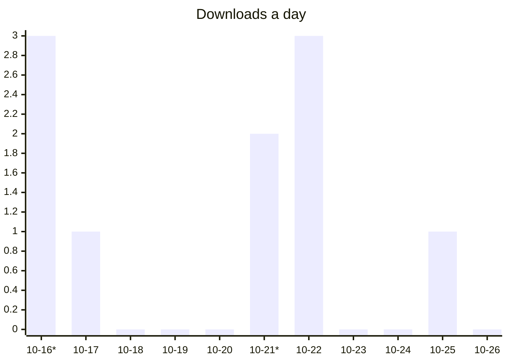
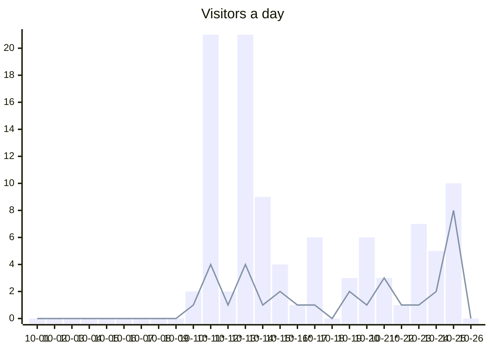

# Usage statistics

Written every day by [the stats workflow](https://github.com/ArtemkaGoldMan/ContextSwitcher/blob/main/.github/workflows/stats.yml); [what the numbers mean](https://github.com/ArtemkaGoldMan/ContextSwitcher/blob/main/docs/usage-statistics.md). Last run 2026-10-26 (UTC).

## Downloads

Every download counts, not every person: one person downloading twice is two. The `.zip` is what the app's own updater, `install.sh` and Homebrew download, so it is roughly the copies that installed or updated to that version; the `.dmg` is downloaded by hand.

| Release | Published | .dmg | .zip |
| --- | --- | ---: | ---: |
| v0.6.8 | 2026-10-21 | 1 | 3 |
| v0.6.7 | 2026-10-16 | 0 | 2 |
| v0.6.6 | 2026-10-15 | 0 | 1 |
| v0.6.5 | 2026-10-15 | 0 | 2 |
| v0.6.4 | 2026-10-15 | 0 | 0 |
| v0.6.3 | 2026-10-14 | 0 | 2 |
| v0.6.2 | 2026-10-14 | 0 | 1 |
| v0.6.1 | 2026-10-14 | 0 | 0 |
| v0.6.0 | 2026-10-14 | 0 | 1 |
| v0.5.0 | 2026-10-13 | 0 | 8 |
| v0.4.1 | 2026-10-13 | 1 | 2 |
| v0.4.0 | 2026-10-12 | 0 | 2 |
| v0.3.0 | 2026-10-11 | 0 | 2 |
| v0.2.0 | 2026-10-10 | 0 | 1 |
| v0.1.0 | 2026-10-10 | 0 | 1 |
| **All** | | **2** | **28** |

Downloads a day (`.dmg` and `.zip`), from one run's totals to the next:



\* A release came out that day: 10-16 v0.6.7; 10-21 v0.6.8.

## Interest

Stars, forks and people watching the repository - the slowest-moving and the most honest sign that someone cares. Now: **4** stars, **0** forks, **0** watching.

```mermaid
xychart-beta
    title "Stars"
    x-axis ["10-21", "10-22", "10-23", "10-24", "10-25", "10-26"]
    line [0, 3, 4, 4, 4, 4]
```

## Visitors

Views of the repository's pages on GitHub and the people behind them, a day. Bars: views. Line: different visitors.



\* A release came out that day: 10-10 v0.1.0, v0.2.0; 10-11 v0.3.0; 10-12 v0.4.0; 10-13 v0.4.1, v0.5.0; 10-14 v0.6.0, v0.6.1, v0.6.2, v0.6.3; 10-15 v0.6.4, v0.6.5, v0.6.6; 10-16 v0.6.7; 10-21 v0.6.8.

| Day | Views | Visitors | Clones |
| --- | ---: | ---: | ---: |
| 2026-10-26 | 0 | 0 | 0 |
| 2026-10-25 | 10 | 8 | 2 |
| 2026-10-24 | 5 | 2 | 5 |
| 2026-10-23 | 7 | 1 | 6 |
| 2026-10-22 | 1 | 1 | 26 |
| 2026-10-21 | 3 | 3 | 130 |
| 2026-10-20 | 6 | 1 | 172 |
| 2026-10-19 | 3 | 2 | 406 |
| 2026-10-18 | 0 | 0 | 17 |
| 2026-10-17 | 6 | 1 | 72 |
| 2026-10-16 | 1 | 1 | 193 |
| 2026-10-15 | 4 | 2 | 338 |
| 2026-10-14 | 9 | 1 | 404 |
| 2026-10-13 | 21 | 4 | 210 |
| 2026-10-12 | 2 | 1 | 117 |
| 2026-10-11 | 21 | 4 | 94 |
| 2026-10-10 | 2 | 1 | 39 |
| 2026-10-09 | 0 | 0 | 0 |
| 2026-10-08 | 0 | 0 | 1 |
| 2026-10-07 | 0 | 0 | 0 |
| 2026-10-06 | 0 | 0 | 1 |
| 2026-10-05 | 0 | 0 | 1 |
| 2026-10-04 | 0 | 0 | 3 |
| 2026-10-03 | 0 | 0 | 0 |
| 2026-10-02 | 0 | 0 | 1 |
| 2026-10-01 | 0 | 0 | 1 |

Clones are almost all automated - CI and bots - and say little about people.

### Where they came from

GitHub's top sites for the 14 days up to 2026-10-26.

| Site | Views | Visitors |
| --- | ---: | ---: |
| m.facebook.com | 6 | 5 |
| Google | 5 | 2 |
| github.com | 2 | 2 |
| artemkagoldman.github.io | 1 | 1 |
| facebook.com | 1 | 1 |
| l.threads.com | 1 | 1 |
| linkedin.com | 1 | 1 |
| teams.public.onecdn.static.microsoft | 1 | 1 |

### What they looked at

GitHub's top pages for the 14 days up to 2026-10-26.

| Page | Views | Visitors |
| --- | ---: | ---: |
| / | 18 | 14 |
| /pulls | 5 | 3 |
| /commits/main | 5 | 1 |
| /releases/tag/v0.4.0 | 4 | 3 |
| /actions | 3 | 2 |
| /releases/tag/v0.3.0 | 3 | 2 |
| /releases | 3 | 1 |
| /security/code-scanning | 3 | 1 |
| /releases/tag/v0.6.8 | 2 | 2 |
| /branches | 2 | 1 |
